# A10 – Lead Screw Translating System

## Objectives

1.) Determine a lead screw diameter from axial stress, calculate range of rotational speed, and select an appropriate lead screw based on the torque given

2.) Determine a nut and flange that best fits the lead screw

3.) design a crosshead based on beam analysis of deflection and stress. Create a Multiview sketch.

4.) Tabulate costs and create assembly in CAD

5.) run FEA on crosshead and determine a better design.

## Analyze
This week's assignment is a group assignment. The goal is to design and build a mechanically driven tester that is capable of applying **2 KN** of axial tensile load, and be able to have a controllable crosshead speed of **1 to 50 mm/min**. 

The group decided it was best to split the work into sections; one member would work on designing the lead screw and the nuts and flanges (Greyson), one member would design the crosshead based on the parameters (Austin), and the last member would tabulate the costs, create CAD assembly and FEA, and edit and assemble the website (J.V.). If a member struggled with a part, other members would help out if needed.

## Decide

### Leadscrew Diameter: Greyson Boatright

#### Lead screw diameter using axial stress
I found the minimum lead screw diameter with the assumption that we were going to analyze the screw under axial stress only. In this analysis, I used the given parameters of a **safety factor of four** and a total force of **2kN** in the resulting equation. Since the two lead screws were identical and the force was distributed evenly between the two, this meant I could divide the total force by two and analyze only one lead screw. The material from the catalog online only gave options for steel and stainless steel which meant I had to make an assumption for the yield strength I was going to use to effectively calculate the allowable stress. Using steel set the yield strength to 250MPa, I solved the equation for the minimum diameter to be **4.5297mm**. Lastly I went through the catalog with the number that had to achieve the minor(root) diameter for the lead screw, I chose a 3/8-16 right handed steel screw temporarily as there was still more analysis to be done.

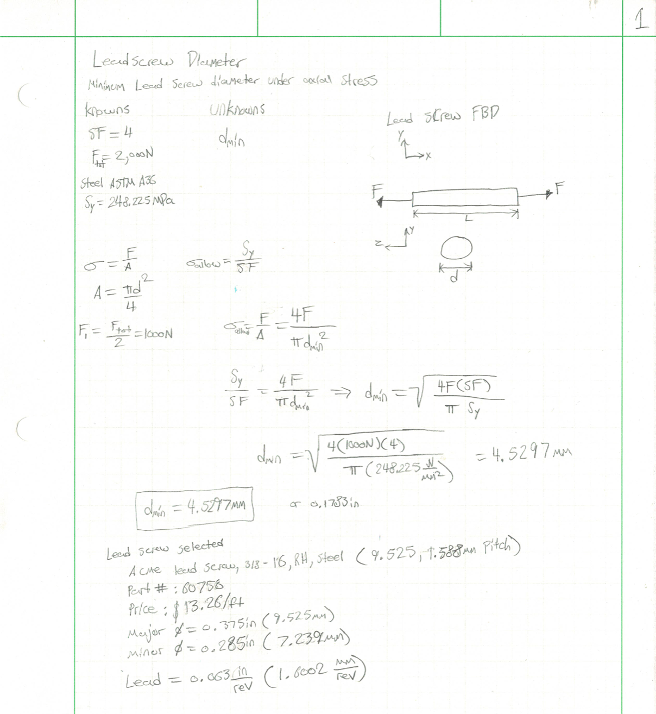

#### Range of rotational speed
The next step was to calculate the range of rotational speed we could achieve with a given range of linear speed. The linear speed that was given was a range of 1 to 50 mm/min. We needed to convert this linear speed to rotational speed, to do this we could divide the speed over the lead. Luckily I was able to easily figure out the lead size as it was given to me through the manufacture of the temporary lead screw. After drawing the free body diagram, identifying knowns and unknowns, I was able to write equations for both the minimum and maximum RPMs, those came out to be **0.625-31.246** and I found that to be a reasonable rotational speed range for what we are trying to achieve.

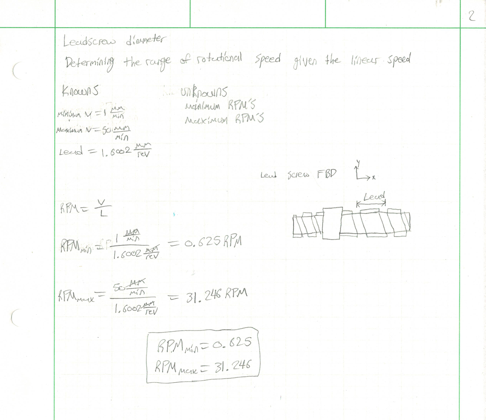

#### Lead screw based on max torque
The last analysis of the lead screw diameter was to find out what the maximum torque would be. I drew a free body diagram of the lead screw and the only unknown in this problem was the torque. With the help of my machineries handbook on page 2647 in the lead screw section there is a formula that goes over how to calculate torque in a lead screw. The formula was T=(PxL)/2pi*e, the formula from the book gave e in English standard and I found e to be 0.25 because I knew we were going to be using a bronze nut. I did have to convert my values into English standard so I could numerically solve and convert back to metric units. The result after algebraically solving and plugging in the values and converting back came out to be 1,018.72 N*mm and I was satisfied with the reult.

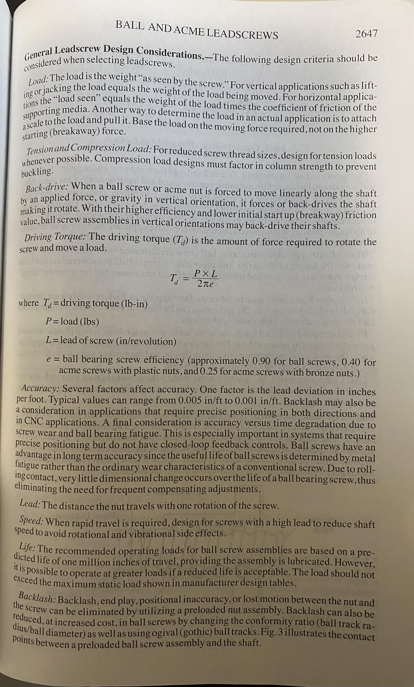
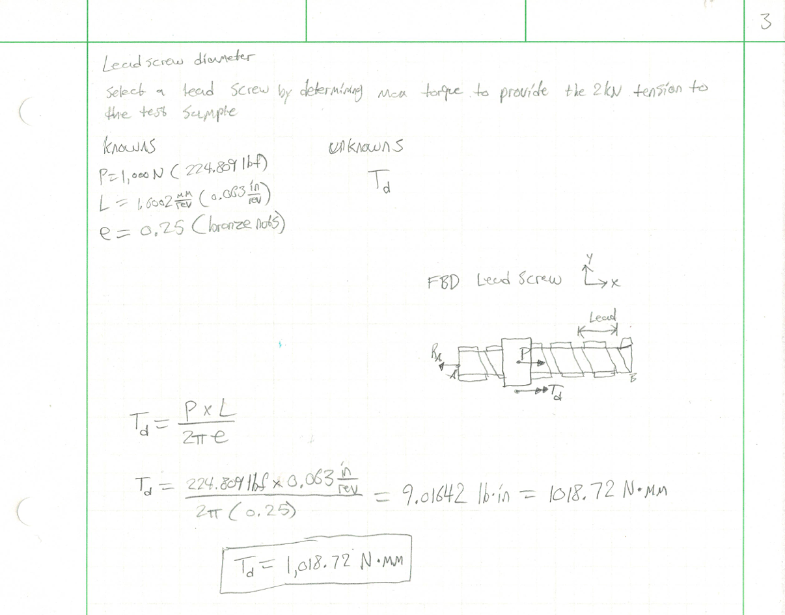

#### Lead screw selection
Overall the analysis of the temporarily chosen lead screw was sufficient and I decided to further continue with my initially chosen lead screw. I eventually went back to where I determined the diameter based upon axial stress and wrote down some key information about the dimensions and part number from the website. In addition to that I took a screenshot of the lead screw straight from the website and embedded it below for visual aid.

Lead Screw Link: https://www.roton.com/product/acme-steel-screw-right-60750/

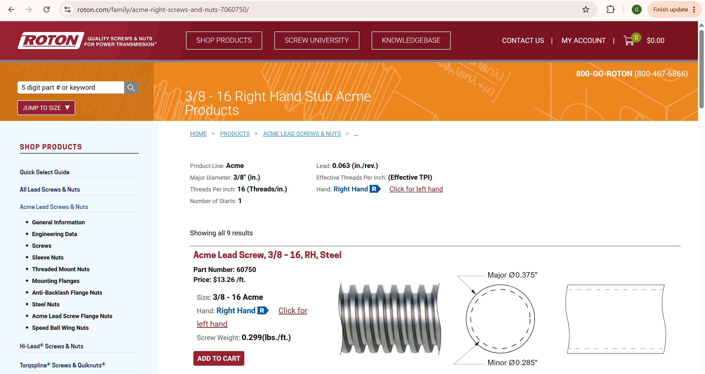

### Selecting a Nut & Flange: Greyson Boatright

#### Selecting the nut/flange based upon thread bending stress analysis
A key part of this assignment is to ensure that the nut and flange we chose for the given lead screw is able to withstand the conditions in which it is put under. For this portion I analyzed the internal threads of the nut due to bending stress. For the knowns of this problem we continued using a safety factor of 4, we only analyze one nut since it is symmetric and that gives us a force of 1kn compared to 2kn. I also knew the minimum diameter of the nut which I based on the major diameter of the lead screw. For the rest of the unknowns I had to gather this information from the nut that mates with the lead screw from the McMaster-Carr website. Doing so I found the length to be **15.875mm**, The material was bronze 673 and so I approximated the yield strength to be 140MPa. For this problem there were two unknowns with one being the pitch and the other being the number of threads in contact. I drew a free body diagram of the nut and lead screw, I was able to find a formula from the lecture that went over calculating the stress due to bending. The pitch was found by dividing 1 by the number of threads per inch which gave **1.5875mm/thread**. Once I found the pitch I was able to find the number of threads in contact by dividing the length of the nut by the pitch which gave us 10. According to the saftey factor of 4 and the yield strength the resulting allowable stress was 35MPa. The formula for stress due to bending was equal to (6F)/(n*pi*d*p), plugging in all over our known values this gave us a result of 13.003MPa which was significantly lower than the allowable stress and met the requirements. I went with the nut I initially selected, wrote down the part number and included additional information below. Also, there were three different flanges that were avalible that all had the same dimensions, just different types of steel. I decided to go with the 1015 carbon steel as it is cost effective and the tester will not be subjected to excessive moisture, thus causing rust. For more information about the flange and nut see below.

Lead Screw Nut Link: https://www.mcmaster.com/95072A129/
Lead Screw Flange Link: https://www.mcmaster.com/95082A641/

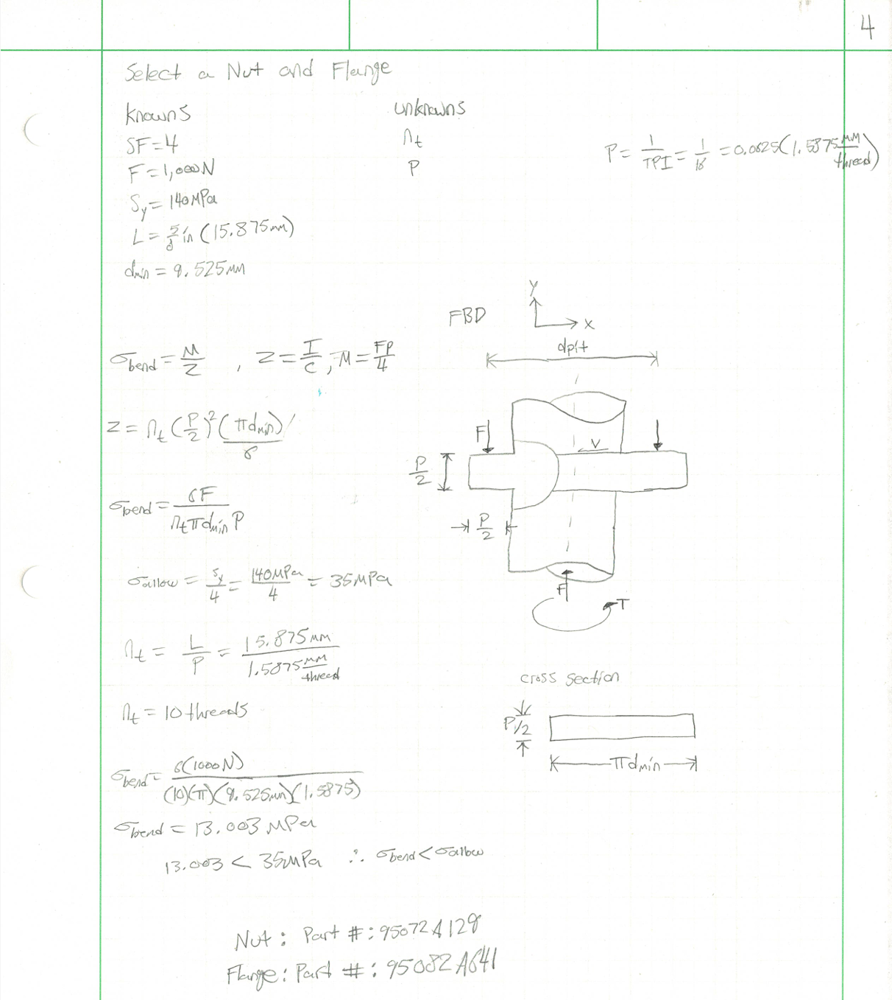
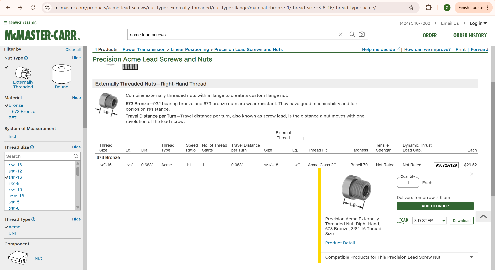
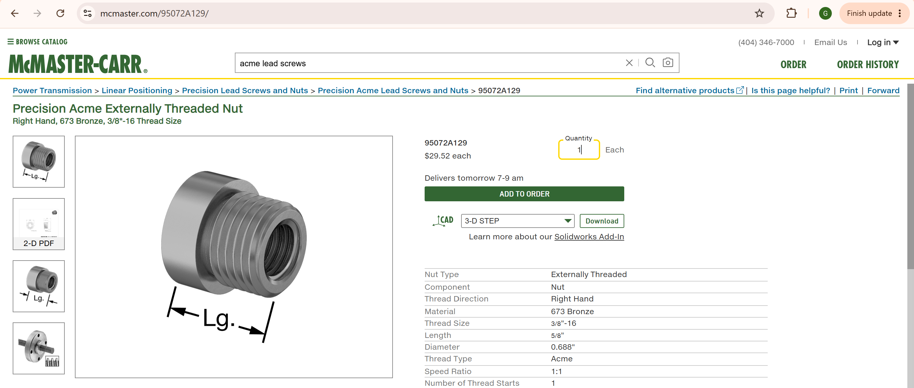
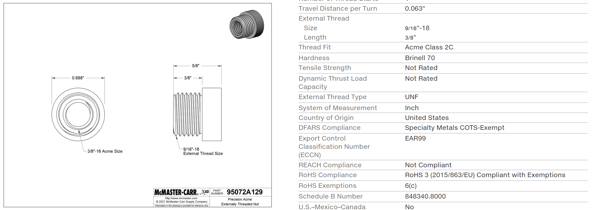
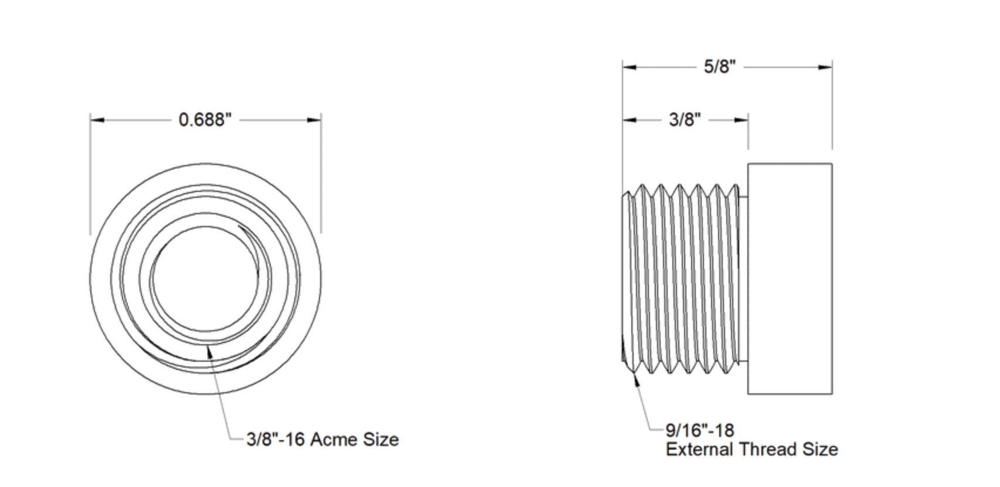
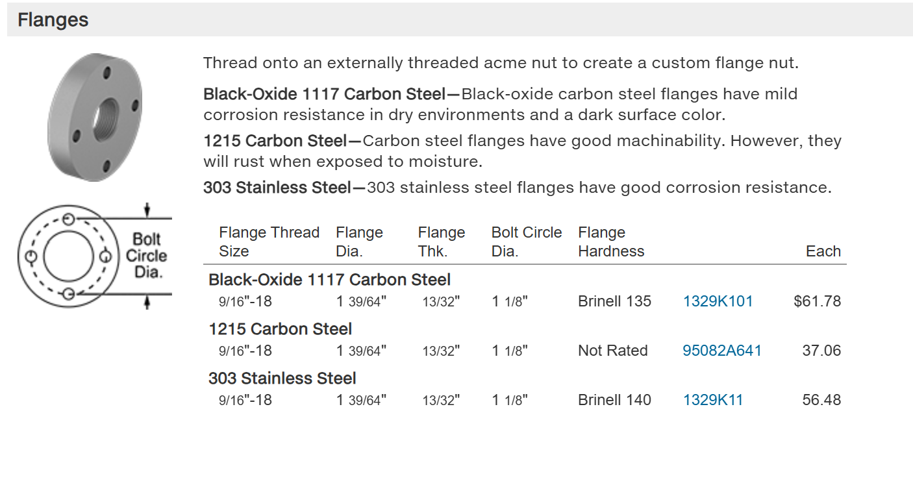
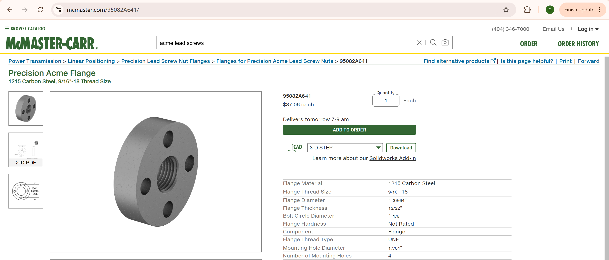
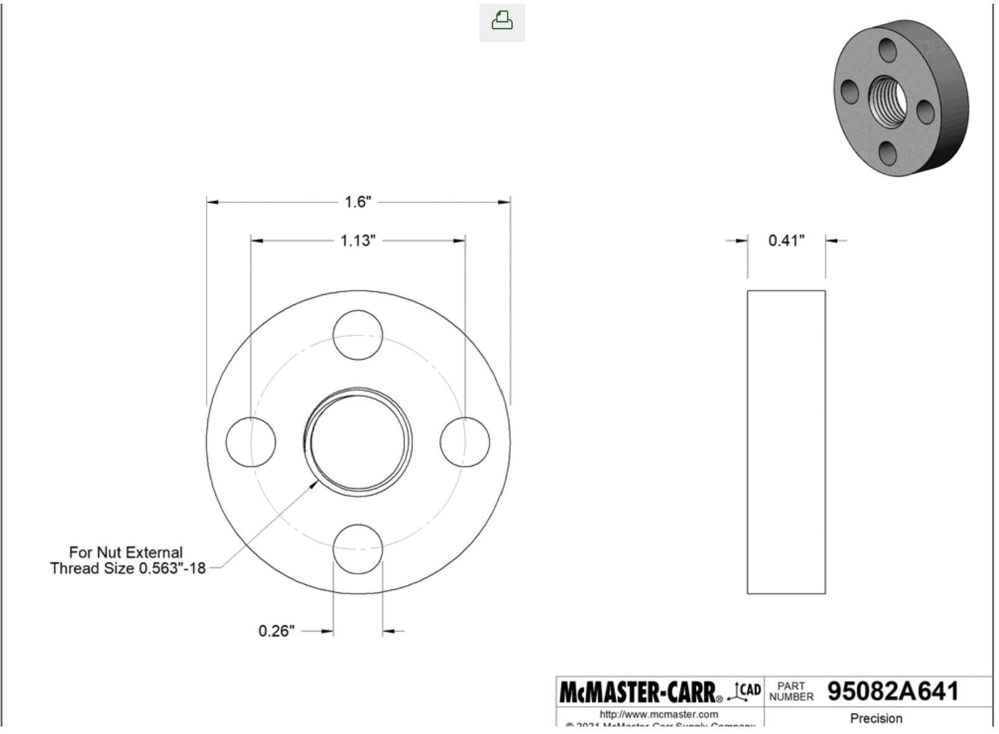
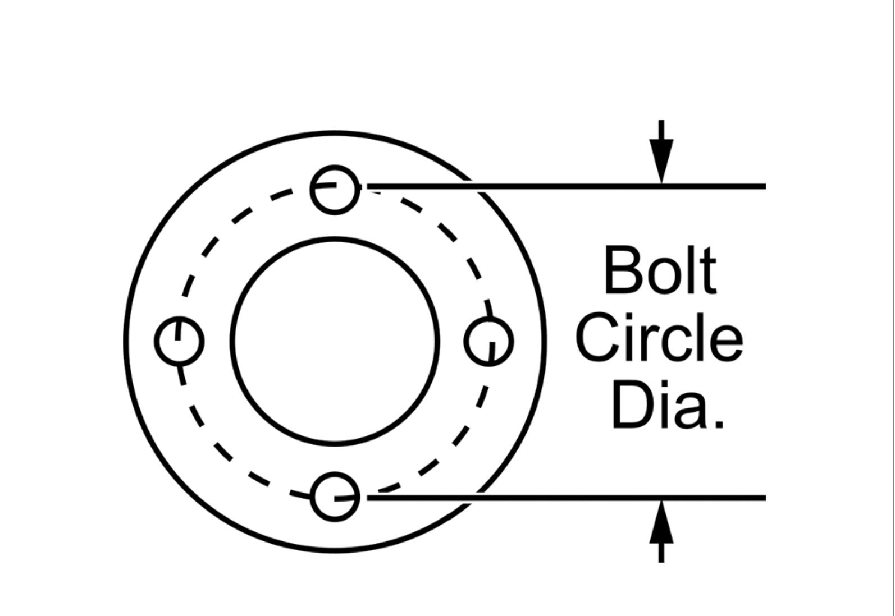

### Cross Head: Austin Hill

In order to determine the appropriate dimensions for the crosshead research was conducted to see what materials and dimensions had been used successfully in the past.
The "Free Loader" testing apparatus proved to be a great starting point for the design concept. The Free Loader has a nominal capacity of 5kN, which is in excess of the assigned capacity, and has a desktop form factor.

#### Free Loader Links

https://www.creativemachineslab.com/freeloader.html

https://www.creativemachineslab.com/uploads/6/9/3/4/69340277/detc2011_amend.pdf

https://www.creativemachineslab.com/uploads/6/9/3/4/69340277/freeloader_manual_v-1-0-0.pdf

Taking the Free Loader as a jumping off point the Cross Head is initial concieved as a roughly 9" (l) x 3" (w) x 1" (thk) beam made of 6061 Aluminum.

Starting from there, proper engineering analysis began. 

#### Cross Head Free Body Diagram

#### Assumptions Made

Assuming the Cross Head acts as a Simply Supported Beam with the lead screws flange and nuts acting as supports and the test connection the load, the calculations for strength and deflection criteria can be confidently calculated using beam deflection/stress formulae from Machinery's Handbook.

Assuming the width of the Cross Head is one third of the length allows the re-arrangement of the beam stress and deflection formulae to solve for thickness.

#### Decided Dimensions

In a flagrant attempt to simplify calculations and unify units, dimensions for the Cross Head were assigned in meters. 0.9m length x 0.3 width (1/3 *length) x some thickness to be calculated by strength and deflection analysis.

#### Material Selection

6061 T6 Aluminum was selected for its abundance and strength, according to Matweb, 6061-T6 has a tensile yield strength of 276 MPa and a modulus of elasticity of 68.9 GPa.

#### Algebraic Calculation

#### Numeric Calculation

#### Stress / Deflection Analysis Conclusion

The thickness to provide necessary strength was found to be 8.1mm but the thickness to provide the required stiffness (maximum deflection of 0.1mm) was found to be 42.8mm. 

Therefore, a thickness of 42.8mm or 1.684inches will suffice for this particular application.

#### Material Source
A billet of 6061 T6 measuring 1.75" thick x 4" Wide x 12" Long is available for purchase from McMaster-Carr (5679N148).
This is very close to the designed 1.68"(42.8mm) thick x 3.937"(300mm) wide x 11.8"(900mm) long.

https://www.mcmaster.com/5679N148/

#### Sketch of Cross Head

### Cost of Material: J.V. Muron

Below is the total cost of all the material and the assembly parts as well.

|          | Item Number | Quantity | Name                | Cost | Purchase Link      |
|----------|-------------|----------|---------------------|------|--------------------|
| | 60750       | 2        | ACME Lead Screw 3/16 RH Steel | $39.78 | https://www.roton.com/family/acme-right-screws-and-nuts-7060750/ |
| | 804T46      | 1        |T-Slot Framing System: Rectangle, 40 Series, Smooth, Double, 3 m Nom Lg, 80 mm x 40 mm, 6 Slots| $211.32| https://www.grainger.com/product/80-20-T-Slot-Framing-System-Rectangle-804T46 |
| | 95072A129   | 2        | Precision Acme Externally Threaded Nut Right Hand, 673 Bronze, 3/8"-16 Thread Size | $59.04 | https://www.mcmaster.com/95072A129/ |
| | 95082A641   | 2        | Precision Acme Flange 1215 Carbon Steel, 9/16"-18 Thread Size | $74.12 | https://www.mcmaster.com/95082A641/ |
| | LC103B-200  | 1        | Omega Load Cell | $336.11 | https://www.dwyeromega.com/en-us/high-accuracy-stainless-steel-s-beam-load-cells/LC103B/p/LC103B-200?utm_source=google&utm_medium=organic&utm_campaign=organicshopping&utm_term=&utm_campaign=Shopping-High+Inventory+Omega_Products&utm_source=adwords&utm_medium=ppc&hsa_acc=3861323739&hsa_cam=23485087147&hsa_grp=191162811839&hsa_ad=793551323277&hsa_src=g&hsa_tgt=pla-2463874841720&hsa_kw=&hsa_mt=&hsa_net=adwords&hsa_ver=3&gad_source=1&gad_campaignid=23485087147&gbraid=0AAAAAD_f1Fsn-M-5KkMXEx8HDlOAKHyBg&gclid=Cj0KCQiAwdDXBhDuARIsAFdLuklScrjDTOTw2McwSR4l6MzFkN4u7_eLSMa6L1Z_1-JVfeT90cgC0J4aAo7hEALw_wcB |
|**TOTAL COST**| | | | $720.37 | | |

Note that tabulated cost does not include the cost of crosshead, machining of crosshead or cutting and welding the frame together.

### CAD Modeling and FEA: J.V. Muron

#### Design of Crosshead
Austin designed the crosshead from his drawings. From here, it was parametrically modeled to allow for the size of the crosshead to be changed to fit any system with the same lead screws. This is the parametric equations used. Note that the length was changed to fit the machine, but the one originally constructed would have worked as well.

#### Assembly of Frame and Tester
The assembly is created from the parts listed above. To create the frame, the 3 meter bar is cut to the frame specifications. Inspiration was taken from the MT01 Tensile Tester. For this specific assembly, the frame dimensions will be **20 inches tall, 18.15 inches wide, and 12 inches deep**.  The frame requires 2 base pieces, 2 runners, and a top and bottom piece in between the two frame parts to hold it together.

Once the pieces of the frame are cut, the body assembly is created for the frame.

After modeling the Crosshead, it is added to the design with the lead screws and the nuts and flanges. These are assembled into one piece and will be added to the frame. The lead screws are **18 inches** long.

The crosshead assembly is then added into the frame of the tester

The assembly is now ready for the loader to be added and ready to test material.

Note this is not the same exact load cell, only a model one of the component.

#### FEA of Crosshead

The crosshead works by moving up and down. This movement is driven by a motor at the top of the assembly. This motor drives the lead screws to turn. The nut turns on the lead screw, driving the crosshead upwards away from the material. To test the forces on the crosshead, and FEA of the crosshead is done to determine the forces it can withstand.

When running the FEA on the crosshead, it is important to know which way the forces are going. The tension caused by pulling on the material is forcing the center of the crosshead **down**. The lead screws, nut, and flanges are being driven **up** by the motor. This creates a fixed constraint on the contact point of the flanges. To create this on the crosshead model, a split face needs to be added where the crosshead will experience the fixed constraint.

Once those areas have the fixed constraint applied, a bearing load of **2kN**  is placed on the hole in the center, where the material is pulling down on the crosshead. This is the max force the crosshead should be able to take. 

 

##### Design 1: No changes to design

###### Iteration 1

Safety Factor: 32.858

Von Mises: 8.40 MpPa

Deflection: 0.0002744 inches

###### Iteration 2

Safety Factor: 33.197

Von Mises:8.314 MPa

Deflection: 0.000762 inches

###### Iteration 3

Safety Factor: 21.399

Von Mises: 12.898 MPa

Deflection: 0.0002835 inches

This design is pretty strong already. While it does not completely converge on the stress and safety factor, it does converge on deflection. This deflection is also well under the maximum deflection of 0.1 mm. Looking at the displacement, there is some torsional strain on the bar. There is slight displacement in the X and Z directions, but most of the deflection is in the Y, which is good.

To compensate for the torsion, diagonal ribs will be added to the crosshead to help counteract the torsion. 

##### Design 2: Diagonal Ribs
The changes were made below. An extra wall thickness of 0.20 inches was added with diagonal ribs of the same thickness.

###### Iteration 1

Safety Factor: 31.055

Von Mises: 8.887 MPa

Deflection: 0.000306 inches

###### Iteration 2

Safety Factor: 30.736

Von Mises: 8.98 MPa

Deflection: 0.000312 inches

###### Iteration 3 

Safety Factor: 21.749

Von Mises: 12.69 MPa

Deflection: 0.0003201 inches

This design had much of the same result, except for now a lot of the force got concentrated onto the center hole. This also did not converge fully, but the displacement still converged. The ribs on the top did help bring down the torsion, but it is still flexing on the sides near the flange. 

Overall, either design would work well, but to save costs the first one can be used. If loading something heavier, it might be best to move to the second design. The ribs could also be added to the bottom as well, but pay attention to the forces around the center hole because it could potentially be a failure mode.

### CAD Files, Drawings, and Assembly Downloads

[Tensile Assembly](Tensile_Tester_Assembly.f3z)

[Redesigned Crosshead](Redesigned_Cossplate.f3d)

[Cross Head Drawing SW](https://github.com/murondj/megr2156-design-portfolio/edit/main/docs/assignments/A10/CrossHead.SLDDRW)

[Cross Head Drawing PDF](https://github.com/murondj/megr2156-design-portfolio/edit/main/docs/assignments/A10/CrossHead.pdf)

### Cross Head 2D CAD Drawing

#### Drawing Notes: Austin Hill

The Cross Head is designed to travel on the lead screws via the nuts secured to the mounting flanges. The design is such that socket head cap screws can be used in the plate and nuts secured from the flange side. This eliminates the possibility of the harder steel bolts galling the threads and potentially tearing out from the aluminum plate.

## Communicate

### Lessons Learned: Greyson Boatright
In this group assignment we learned a vital lesson in team work, just as you would in industry there are often engineering projects in which you have to work with a team of engineers and/or other departments. There are task that need to be done before other phases of a project can be accomplished and this assignment was a perfect example of this. Before we could even start modeling anything there had to be hand calculations done with an analysis of the assembly and its individual components. Another lesson learned in this assignment was to consider critical factors in making engineering decisions, for example when it came to choosing the required sizes for components there were many choices in material such as the type of steel. In making the decision in the material there was an in depth analysis in what the life cycle, conditions, etc. of the tester would be used. Another factor in making material decisions was cost, some were more economical than others and even though there was not a set budget, keeping economically sounds choices were taken into consideration. In total we spent about 25 hours working on the assignment.

