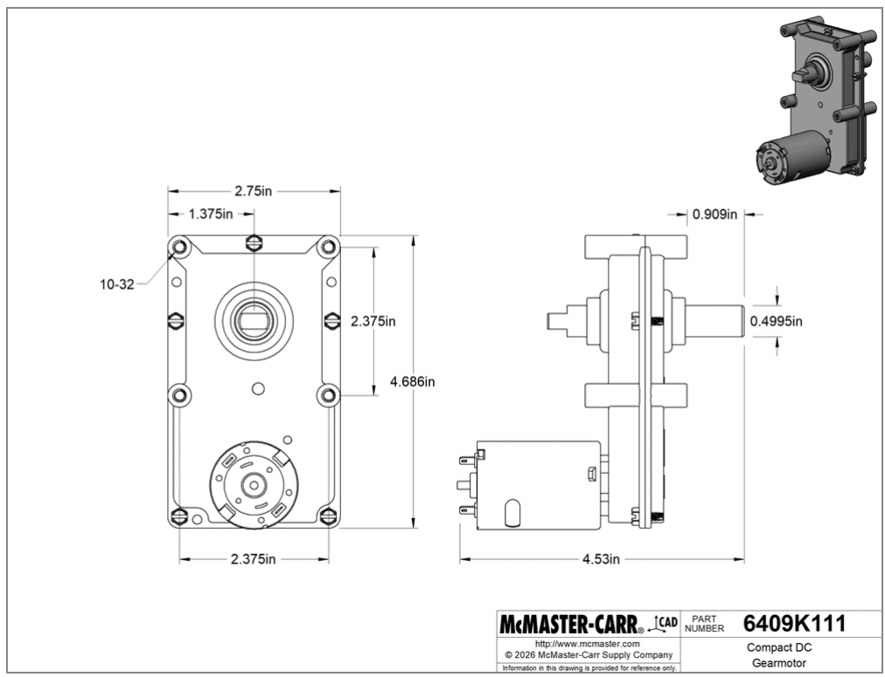
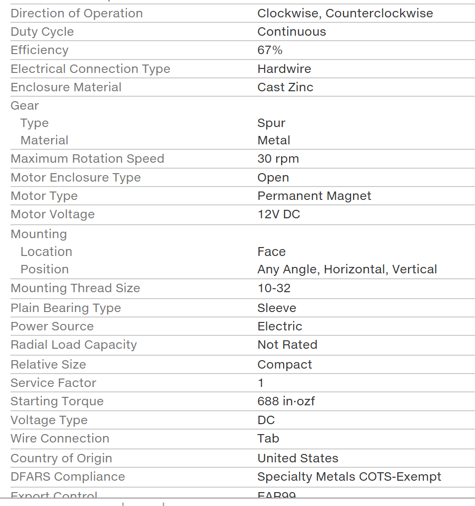
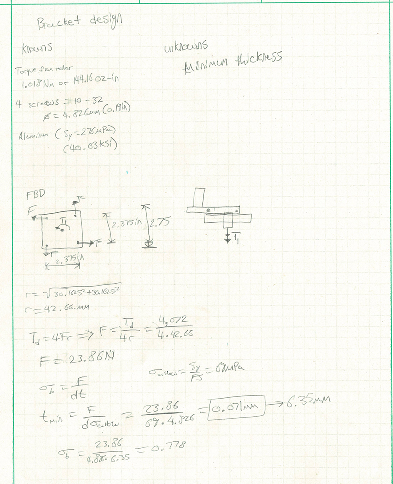
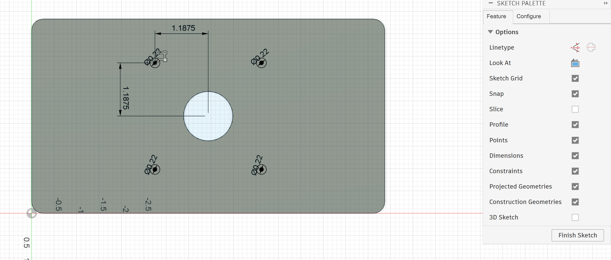
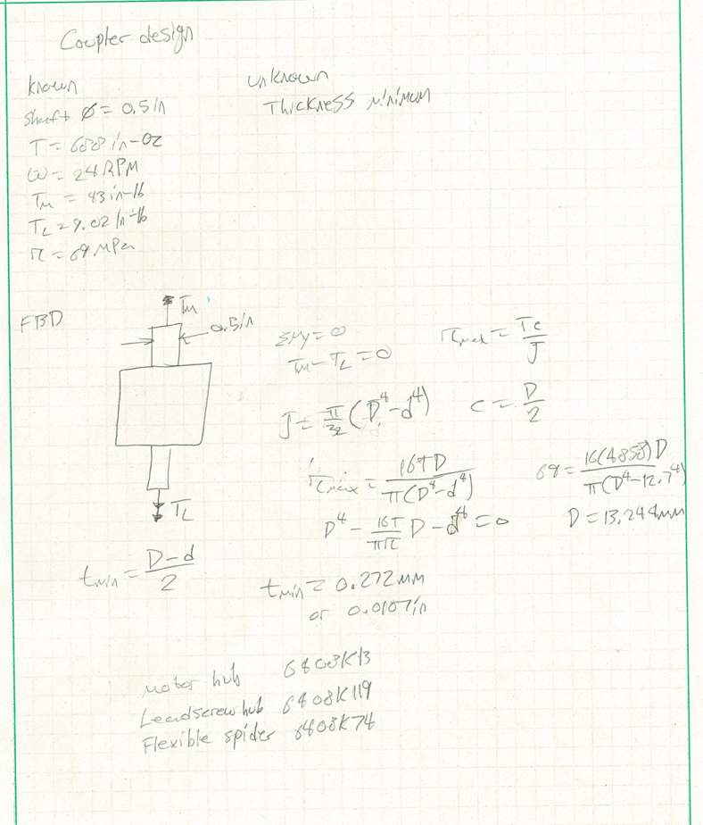
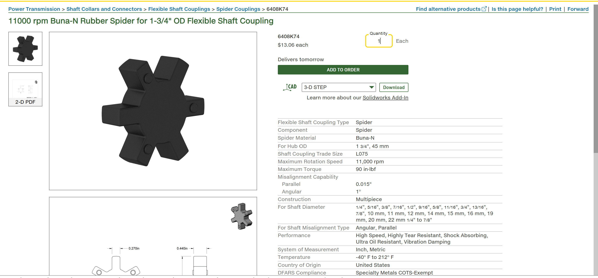

# A11 – Motor Selection

## Objective

## Analyze
This week's assignment is a continuation of the design and assembly of a tensile tester. This portion will focus on the motor selection to drive the lead screws, frame, mounting, and clamping of the tensile tester.

### Motor Selection & Attachments: Greyson Boatright

#### Motor Selection

When selecting the motor for the tester, it had to meet the requirement of 2kn of force, in total, I broke this up as one motor was responsible for one leadscrew and assuming this force was disturbed equally that mean 1kn for each. From previous calculations the required torque needed to be achieved was 1.019N*m and the range of the screw speed was between 0.63 to 31.5 RPM. It took me a while to find a suitable motor for this project but I ended up going with compact DC gear motor that meet the required values I was looking for according to the product details and speed torque curve.

Motor Link(6409K111 at $127.33 each): https://www.mcmaster.com/6409K111/

#### Motor Mount Bracket
The bracket is pretty straight forward, after doing some calculations to find the minimum thickness of 0.071mm I decided to go up to 6.35mm or 0.25in for simplicity. Since the motor could be mounted in a conventional way I created a rectangular plate that would serve as the mount. I created the mount in a rectangular shape and gave the edges a small radius to smooth them out. The hole for the shaft is placed in the center and is large enough for the shaft and the couple. Around the center hole are four holes for the 10-32 screws to attached the bracket to the motor, I utilized the pattern feature on this part to ensure all holes were constrained appropriatly. I repeated the same process for the holes that would attach the mount to the frame of the tester with their respective dimensions. Lastly, I decided to make the mount out of Aluminum since that is the yield strength I did the calculations with.

[Download the Motor Mount Bracket](./Motor%20Mount%20A11.f3z)

#### Coupler Selection

For the couple design, I examined the torques in the leadscrew and in the shaft to decide the minimum thickness the couple would need. After drawing a free body diagram I was able to set up an equation for torsional shear stress and solve for the inside diameter. I then found the minimum thickness which was 0.272mm or 0.0107in. I decided to go onto McMaster Carr and select a coupler, I was able to find a coupler assembly, it came with a hub for the motor, a hub for the leadscrew, and a flexible spider that would lock the two together when transferring torque. All of the parts for the coupler and the motor were relatively cost friendly which is one of the factors I tried implement in my analysis.

Link for coupler components

Motor Hub(6408k13 at $14.71 each): https://www.mcmaster.com/6408K13/

### Analyzing and Designing the Frame - J.V. Muron

For the design of the frame, the way the frame is assembled is important to how the machine will be affected under load. An FBD of the top bar and vertical runners is conducted to pick the proper fastening technique for the 40 Series bars from the previous assignment.

Looking at the mock-up assembly, there is no clear way to assemble the top piece practically. To solve this issue, the header bar length will be extended **over** the vertical runners and **reorientated** to have the flat side on top of the vertical runners. This orientation allows for the top runner to be calculated as a beam, while also increasing the bending moment, due to the larger cross section. The new length of the top runner is **17.278 inches minimum**. There is extra material so this is not a problem. The new length of the bar will be **18.258 inches**.

#### FBD of Top Bar and Vertical Runners
Treating the top runner as a bar under transverse, torsional, 

### Frame Assembly Adjustments - J.V. Muron

### Design of floating bearing for lead screws - Austin Hill

In order to prevent transverse deflection from buckling in the lead screws, floating bearings were designed.
The fit was assigned to be class RC3. 
Per Machinery's Handbook RC3 is a precision fit with a minimum clearance of 0.0005" and a maximum clearance of 0.0015"
Also per Machinery's Handbook, the tolerance allowed for the major diameter of a 3/8"-16 Acme lead screw is +0.000" / -0.005".

#### Shaft diameter
This means that the lead screw will need to be machined or cylindrically ground to achieve the desired fit.
The minor diameter of a 3/8"-16 acme lead screw (per guess who) is 0.3025" +0.000" / -0.0168". 
Given that the motor coupling will already be 0.250" I decided on a bearing shaft nominal diameter of 0.250".
Per table 9a of Machinery's Handbook, the pin tolerance for a 0.250" nominal RC3 fit is -0.0005" / -0.0009".
This puts the machined diameter of the bearing side (bottom, or ODE if you're nasty) at 0.2493  +/- 0.0002"
Also per table 9a of Machinery's Handbook, the hole tolerance for a 0.250" nominal RC3 fit is +0.0000 / +0.0006.
This puts the final hole size of the bearing at 0.2503 +/- 0.0003".

#### Volumetrics
Bearings are seldom useful if they do not stay in place about the axis of rotation.
This means that we're going to have to find some way of securing the bearing into place relative to the frame of the machnine.
Fortunately we have the convenience of ready-made series 40 frame with a convenient t-slot.
The width of the section of T-Slot where the Bearing will affix is 1.325" (not including the fillet edge)

This will serve as the width of the bearing plate.
Some oversizing of this dimension will not critically affect performance so we'll take 1.325" as a minimum for tolerancing.

For the length I started with 2.25" estimating some need for screw heads and t-slot nuts.
I established an axis in the model through the lead screw to locate the ends of the bearing length.

For the height I estimated that if 0.25" is good enough for the diameter then it is good enough for the bearing height.
One small wrinkle is that I did over-cut the 0.2493 diameter 0.016" farther on the lead screw. 
There needs to be some gap between the machined face (normal to rotation) on the lead screw and the bearing or else any deflection will cause excess friction and prevent accurate loading of the sample.

The headspace dimension of 0.016" accounts for roughly four times the maximum deflection (0.1mm) allowed int he parts

## Decide

## Communicate
